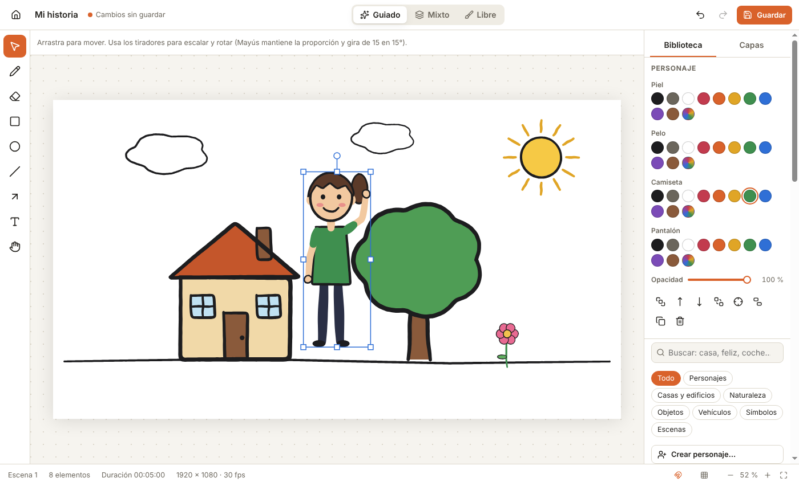

# Dra-Wings

**Dra-Wings** es una aplicación de escritorio para crear historias visuales narradas, vídeos estilo Draw My Life y animaciones sencillas sin exigir conocimientos de dibujo.

También ofrece herramientas de dibujo y animación libres para usuarios que prefieren trabajar sin ayudas.



## Modos de creación

- **Guiado:** personajes, objetos, composiciones y ayudas editables.
- **Mixto:** biblioteca y dibujo libre en un mismo proyecto.
- **Libre:** lienzo y herramientas sin ayudas obligatorias.

Los modos comparten el mismo formato de proyecto.

## Estado

M0 a M3 completados: arquitectura, proyectos con guardado y recuperación, lienzo y dibujo, y biblioteca con modo guiado. Siguiente: M4, animación y línea de tiempo. Ver `ROADMAP.md`, `docs/EDITOR.md` y `docs/LIBRARY.md`.

## Principios

- Aplicación de escritorio, inicialmente para Windows.
- Proyectos locales y editables.
- Edición no destructiva siempre que sea viable.
- Línea de tiempo visual para dibujo, animación y audio.
- Exportación de vídeo con audio sincronizado.
- Sin generación de imágenes por IA ni servicios en la nube como requisito del MVP.

## Desarrollo

Requisitos: Node.js 22 o superior.

```bash
npm ci             # instalar dependencias
npm run dev        # app en modo desarrollo con recarga en caliente
npm run check      # lint, formato, typecheck y pruebas unitarias
npm run build      # compilar
npm run test:e2e   # pruebas E2E con Electron (requiere build; en Linux sin pantalla: xvfb-run -a)
```

Estructura: `src/main` (proceso principal), `src/preload` (puente seguro), `src/renderer` (interfaz React), `src/core` (modelo, tiempo y, más adelante, motor y render; TypeScript puro), `src/shared` (contrato IPC) y `tests/` (unitarias y E2E).

Arquitectura y decisiones: `docs/ARCHITECTURE.md` y `docs/decisions/`. Normas de trabajo: `CLAUDE.md`, `AGENTS.md` y `prompts/README.md`.

Toda contribución debe seguir el flujo de ramas y Pull Requests descrito en `CONTRIBUTING.md`.
