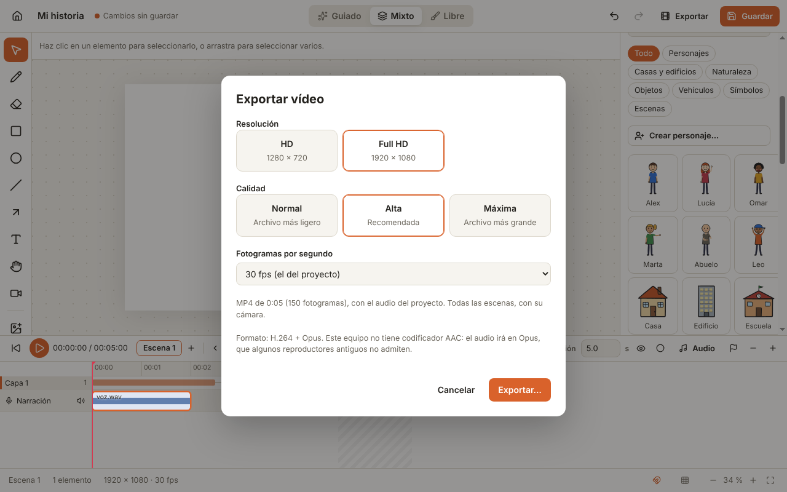

# Audio y exportación

Decisión de base: ADR-004 (WebCodecs + mediabunny, sin FFmpeg empaquetado).

## Medios del proyecto (M5)

- **Importar:** diálogo nativo en el proceso principal (canal `media:import`). Se valida la extensión y el tipo esperado (imagen o audio) y se limita el tamaño (50 MB por imagen, 500 MB por audio). El archivo se lee una vez, se calcula su SHA-256 y se escribe de forma atómica en `userData/media-cache/<sha256>.<ext>`. El renderer nunca envía ni recibe rutas.
- **Leer:** el renderer pide `app://dra-wings/media/<sha256>.<ext>`. El protocolo solo acepta nombres con ese patrón y sirve desde la caché (403 para cualquier otro nombre).
- **Guardar:** los medios usados se escriben en `media/` dentro del `.dwings`, sin comprimir. Los que ya no usa ningún elemento ni clip se omiten del archivo, pero siguen en la caché: deshacer después de guardar no pierde nada.
- **Abrir:** los medios del archivo se extraen a la caché comprobando que su contenido coincide con su hash (si no, el archivo se considera dañado). Si falta alguno, el proyecto se abre igualmente, se avisa y los elementos afectados se ven como un marcador gris.
- **Tipo real:** el proceso principal decide el tipo de cada medio por su firma (los primeros bytes), no por la extensión ni por lo que diga el renderer. Un archivo que no es lo que dice ser se rechaza.
- **Bytes desde la interfaz** (canal `media:import-bytes`): para las grabaciones y los archivos soltados en la ventana, el renderer envía el contenido, nunca una ruta. Se aplican el mismo límite de tamaño y la misma comprobación de firma.
- **Arrastrar desde el explorador:**
  - Imágenes al lienzo: se colocan centradas donde se sueltan (varias a la vez, escalonadas).
  - Audio a la línea de tiempo: en el instante donde se suelta. Sobre una pista de audio va a esa pista; si no, la app pregunta si es narración, música o efecto.
  - Lo que no es imagen ni audio se rechaza con un aviso, y soltar fuera de esas zonas no hace nada.
- **Imágenes:** PNG, JPG, WEBP y GIF (solo el primer fotograma). Se decodifican con `createImageBitmap`, que respeta la orientación EXIF. Se colocan centradas, como mucho al 60 % de la hoja, y entran con un fundido de 1 s según el tiempo automático.

## Audio en el editor (M5)

- **Grabar la narración** (menú «Audio» → «Grabar narración…»):
  - El permiso del micrófono se concede solo para audio (nunca la cámara) y solo a la propia interfaz; el resto de permisos siguen denegados. En Windows, además, el micrófono debe estar permitido para las aplicaciones de escritorio en la configuración de privacidad (la app lo explica si está bloqueado).
  - Medidor de nivel, cuenta atrás de 3 s y, opcionalmente, la animación reproduciéndose mientras se graba para ir narrando sobre ella. Máximo 20 minutos por toma.
  - Al detener, la toma se convierte a WAV mono de 16 bits a 48 kHz; la escucha previa es ese WAV (exactamente lo que se guardará). «Usar grabación» la coloca en la pista de narración en el instante en que empezó la grabación.
- **Formatos:** MP3, WAV, OGG/Opus, M4A/AAC y FLAC, es decir, lo que decodifica el Chromium de Electron. Se decodifica con un `OfflineAudioContext` a **48 kHz**: no depende del dispositivo de salida y es la frecuencia que usará la exportación. Si la decodificación falla, se muestra un error y no se añade nada.
- **Pistas:** narración, música y efectos, en ese orden. Se crean al importar el primer clip de cada tipo y desaparecen al quedarse vacías. Cada una tiene volumen (0–200 %) y silencio.
- **Clips:** posición en el tiempo global del proyecto (`start`), recorte (`sourceOffset` y `duration`, sin salirse del archivo y con un mínimo de 0,1 s), ganancia (0–200 %), fundidos lineales de entrada y salida (nunca suman más que el clip) y dividir en el cabezal.
- **Colocación:** un clip nuevo empieza en el cabezal. Si choca con otro de la misma pista, se encadena detrás, para ir añadiendo frases de narración seguidas.
- **Duración del vídeo:** la narración alarga la última escena si termina después del final (se avisa). La música y los efectos se cortan al final del vídeo.
- **Forma de onda:** picos mínimo y máximo, 100 por segundo, calculados una vez por audio y guardados solo en memoria. El lienzo de cada clip mide como mucho 4096 px y se estira con más zoom.
- **Marcas:** en tiempo global, con nombre editable. Se añaden con M o con el botón de la bandera, y se arrastran en la regla. Al arrastrar barras, clips o marcas, se pegan a las marcas y al cabezal (Alt lo desactiva).
- **Mezcla:** `scheduleProject(ctx, project, buffers, desde)` (`src/core/audio/mix.ts`) programa todos los clips, con su ganancia, el volumen de su pista y sus fundidos, sobre cualquier `BaseAudioContext`. La reproducción lo usa con un `AudioContext` y la exportación (M6) lo usará con un `OfflineAudioContext`: la mezcla exportada será la misma que se escucha.
- **Reproducción:** el reloj maestro es `AudioContext.currentTime`, así que la imagen sigue al sonido. Si el reloj del audio no avanza durante 400 ms (por ejemplo, sin dispositivo de salida), se pasa al reloj de pared para que la vista previa no se congele. Si el audio del documento cambia durante la reproducción, o termina de cargarse un clip, se reprograma desde el instante actual.
- Nada de audio sale del equipo. Los registros no incluyen nombres de archivo ni contenido.

## Exportación (M6)

1. **Diálogo** (botón «Exportar» o Ctrl+E): resolución HD (lado corto de 720) o Full HD (1080) con la proporción de la hoja; calidad Normal, Alta o Máxima (`QUALITY_MEDIUM`, `QUALITY_HIGH` y `QUALITY_VERY_HIGH` de mediabunny); y FPS (por defecto, los del proyecto). Antes de exportar muestra la duración, los fotogramas, si lleva audio y **qué códecs se usarán**. Si no hay AAC, avisa de que el audio irá en Opus. Los ajustes no se guardan en el proyecto: exportar no lo modifica.
2. **Destino:** diálogo nativo en el proceso principal (con confirmación si el archivo existe). El proceso principal abre `<destino>.part` y devuelve al renderer un identificador opaco: el renderer nunca ve la ruta.
3. **Preparación (hilo de interfaz):** copias de las imágenes usadas (`ImageBitmap`) y mezcla de todo el audio con `scheduleProject` sobre un `OfflineAudioContext` estéreo a 48 kHz. Si falta algún medio, la exportación se detiene con un mensaje claro.
4. **Worker de exportación** (`src/renderer/src/export/export-worker.ts`): carga las mismas fuentes que el editor, dibuja cada fotograma con `drawProjectFrame` (la misma función que la vista previa: fondo, cámara, apariciones y keyframes) sobre un `OffscreenCanvas` del tamaño final y lo codifica con WebCodecs a través de mediabunny. El audio se intercala por tramos de 1 s, un poco por delante del vídeo. El instante de cada fotograma es exacto (`f × ticks por fotograma`).
5. **Escritura:** MP4 sin *fast start* (metadatos al final): se escribe de forma progresiva con memoria constante. mediabunny entrega trozos de hasta 4 MiB con su posición; el worker los pasa al hilo de interfaz, este al proceso principal (`export:write`), y cada trozo espera confirmación antes del siguiente. El proceso principal valida el identificador, la posición y el tamaño.
6. **Final:** `fsync`, cierre y renombrado de `.part` al destino. **Cancelar** (o cerrar la ventana) termina el worker y borra el `.part`; si el destino ya existía, queda intacto.
7. **Resultado:** nombre del archivo, códecs, tiempo empleado y «Mostrar en la carpeta».

**Verificación:** las pruebas E2E demultiplexan el MP4 con mediabunny en Node y comprueban códecs, tamaño, número de fotogramas, duración y la pista de audio. A mano se comprobó con ffprobe y ffmpeg que vídeo y audio empiezan en 0, que el vídeo dura lo exacto y que el audio tiene el nivel del original. No hay verificación dentro de la app: la escritura ya está validada y verificar exigiría volver a leer el archivo entero.

## Códecs por plataforma (medido con Electron 45.3.3 / Chromium 156)

| Plataforma | Vídeo (H.264) | Audio AAC | Opus | VP9 / AV1 | HEVC | Resultado de exportación |
|---|---|---|---|---|---|---|
| Windows (GitHub Actions, sin GPU) | Sí (software) | **Sí** | Sí | Sí / Sí | No | H.264 + AAC, 0,53 s para 5 s de 720p, desfase A/V 0,0 ms |
| macOS arm64 (GitHub Actions) | Sí (software) | **Sí** | Sí | Sí / Sí | Solo decodificación | H.264 + AAC, 1,3 s para 5 s de 720p, desfase A/V 0,0 ms |
| Linux (contenedor, sin GPU) | Sí (OpenH264) | **No** | Sí | Sí / Sí | No | H.264 + Opus en MP4, 0,7 s, desfase A/V 0,0 ms |

Preferencia: H.264 + AAC. Si no hay codificador AAC (Linux, Windows N), se exporta H.264 + Opus en MP4 y se avisa de que algunos reproductores antiguos podrían no reproducir el audio.

## Riesgos abiertos

- **Rango de color:** OpenH264 marca `yuvj420p` (rango completo, `color_range=pc`, confirmado de nuevo en M6). Queda por comprobar a mano que los colores se ven igual en el reproductor de Windows (que usa Media Foundation y probablemente produzca rango limitado); WebCodecs no permite elegir el rango.
- **Codificación por hardware:** en los runners sin GPU solo se ha visto la ruta por software. En equipos reales, `prefer-hardware` podría acelerar, pero también introducir diferencias. Por ahora se usa `no-preference`.
- **Vídeos largos:** la escritura es progresiva, pero el audio mezclado se mantiene en memoria (unos 23 MB por minuto). Falta medir 10 minutos a 1080p en hardware real (M7).
